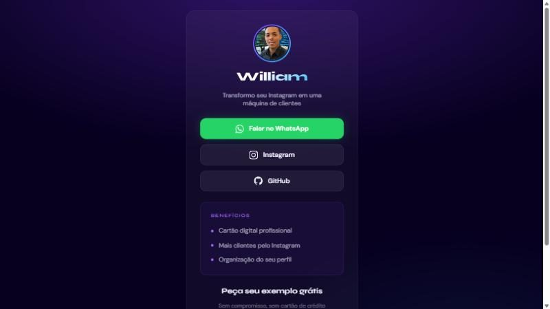

# Cartão Digital

Cartão digital profissional em formato de landing page minimalista, feito para transformar visitantes do Instagram em clientes pelo WhatsApp.



🌐 **Acesse:** https://kondoca.github.io/kartao-digital/

## Sobre o projeto

A página reúne foto, uma frase de apresentação do serviço e um botão de WhatsApp em destaque, além de links para Instagram e GitHub, uma seção de benefícios e uma chamada para ação. Foi criada para praticar estruturação de páginas e estilização com CSS, com foco em layout e design moderno.

## Funcionalidades

- Design escuro (roxo + azul neon) com efeito de vidro (glassmorphism)
- Botão do WhatsApp em destaque, com animação de brilho
- Animações de entrada suaves, que respeitam a preferência de movimento reduzido do sistema (`prefers-reduced-motion`)
- Layout em formato de cartão, pensado para celular
- Metatags Open Graph para a prévia do link ao compartilhar
- Sem frameworks: só HTML e CSS

## Tecnologias

- HTML5
- CSS3 (gradientes, animações e glassmorphism)
- Google Fonts (Syne e DM Sans)

## Como executar localmente

```bash
git clone https://github.com/Kondoca/kartao-digital.git
cd kartao-digital
```

Depois, abra o arquivo `index.html` no navegador.

## Como personalizar

- **Foto:** substitua `Imagens/Perfil.png`
- **Links:** edite os endereços do WhatsApp (`https://wa.me/55DDDNUMERO`), Instagram e GitHub no `index.html`
- **Cores:** no `style.css`, procure por `#8a2be2` (roxo), `#00d4ff` (azul neon) e `#25d366` (verde do WhatsApp)
- **Textos:** todo o conteúdo está direto no `index.html`

## Estrutura

```
kartao-digital/
├── index.html      # Estrutura da página
├── style.css       # Estilos e animações
├── Imagens/
│   └── Perfil.png  # Foto do perfil
└── docs/
    └── preview.jpg # Imagem usada neste README
```

---

Feito por [William Kondoca](https://github.com/Kondoca)
